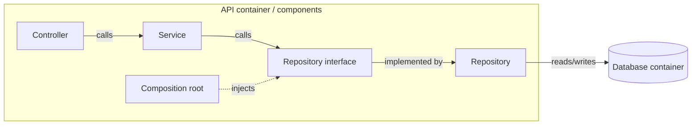

# Structural Analysis Techniques

This file defines the mandatory **as-is C4 preflight** and provides mapping techniques. Follow [Workflow](../workflow.md) for target derivation, necessity tests and verification. C4 records what exists; its boxes are **not** target architecture requirements.

## Mandatory C4 as-is preflight

Before any repository-code architecture, cleanup, implementation or optimization decision, **draw the whole current system**. Inspect actual source: bootstraps, deployables, entrypoints, dependency wiring, constructors, call sites, storage, ownership and external interfaces. No design candidate, `KEEP`, `REMOVE`, tuning choice or module route is decided until the map is available and grounded.

- **L1 — System Context:** whole system, users/actors, external systems, real interactions.
- **L2 — Container:** all first-party deployables/processes and datastores and their actual connections/protocols. A C4 container is **not** an internal Service/Repository class.
- **L3 — Component:** components **inside every first-party container** and directed dependencies/calls. Expand Controller → Service → Repository, SOLID-style interfaces with one implementation, DI factories/composition roots, DTO/Mapper/ViewModel hops, adapters and duplicated semantic layers. Split into multiple connected diagrams when needed for readability; do not conceal chains inside generic boxes.
- **L4 — Code/data path:** typed operations and data for the affected path only, including inputs/outputs, ownership, allocation/lifetime, retained representations and pointer/ID/range links.

Use C4 diagrams or Mermaid with explicit boundaries, directed labeled edges and consistent names. Differentiate DI construction from runtime invocation and data movement. Attach representative source locations to nodes/edges, mark unverified links `UNKNOWN`, and **do not invent** graph edges. If current code cannot establish a complete system-wide L1–L3, state the missing scope and **block design selection**; never silently substitute a local graph.

Annotate SOLID/DI indirection, delegation-only layers, redundant DTO conversions, duplicate owned state, per-object heap/lock graphs as `CANDIDATE` on the **as-is** map. A visible layer is not yet a proven defect: only the subsequent physical-operation derivation, necessity test and correctness/constraint checks can justify deleting or keeping it. Reuse a previous diagram only after checking its repository revision and affected entrypoints/wiring.

### Example: expose a delegation chain at L3

This illustrates what to **show**, not what to preserve. Draw actual L1–L3 for the repository before making a design decision.

## Typed process maps

After the whole-system C4, map the affected input-to-output path in typed detail. Unrelated L4 code stays collapsed at its C4 boundary.

Every operation must name:

- the concrete operation;
- input and output types;
- retained state read or written;
- multiplicity or call count when known.

Use Mermaid when supported, or a typed table. Text diagrams are a fallback when rendering is unavailable. Example table:

| Operation | Input | Output | Retained state | Multiplicity |
| --- | --- | --- | --- | --- |
| parse | `&[u8]` | `Ast` | none | once/build |
| resolve | `Ast` | `Vec<ResolvedModel>` | read `HashMap<String, ModelId>` | N names/build |
| build | `Vec<ResolvedModel>` | `Runtime` | write `Vec<Arc<Mutex<Model>>>` | N models/build |
| execute | `Request` | `Response` | read/write `Runtime` | Q requests |

Generic boxes such as “service”, “manager”, or “processing” do not identify an operation or data type.

Annotate the operations or boundaries that incur:

`parse`, `normalize`, `hash`, `lookup`, `copy/clone`, `allocate`, `serialize`, `lock`, atomic reference counts, IPC/syscalls, ownership transfer, or state transitions.

Separate one-time build costs from recurring request costs. Use `N` items, `M` edges, `Q` requests, and `?` for unknown counts. Do not invent measurements from type names.

## Retained-data maps

Identify the root owner and concrete retained containers/records used by the path. For each relevant structure identify:

| Property | Required distinction |
| --- | --- |
| Owner and lifetime | build-only, request-local, snapshot, or runtime |
| Authority | canonical data, derived copy, index/view, or scratch |
| Mutation | frozen, locally mutable, or concurrently mutable |
| Relationships | pointer, typed ID, offset/range, or key |
| Consumers | actual readers/writers and last required use |
| Physical size | element count, bytes, capacity, independent allocations; `?` if unknown |

For example, `HashMap<String, Arc<Model>>` plus per-model `Vec<Arc<Model>>` and owned strings has a different allocation/ownership shape from root-owned arrays, even if raw payload bytes are similar.

Do not label build-time maps or ASTs as defects merely because they are temporary. The question is whether they survive their last required consumer.

## Counting work and allocation shape

Use the same scope and units for current and candidate. Select the metrics affected by the decision:

| Metric | What to count |
| --- | --- |
| Steps and full passes | distinct transformations; repeated whole-input visits |
| Identity work | pointer hops, key lookups, hashes, parse/normalize calls |
| Data movement | copies/clones and copied bytes |
| Allocation | number of allocations, capacities, retained and peak bytes |
| Coordination | locks, atomic reference counts, shared-state transitions |
| Boundaries | serialization, IPC/protocol round-trips, syscalls |
| Duplicate state | retained representations of the same semantic facts |

Count allocation shape separately from byte totals. A design with N entity allocations, M child vectors, and S owned strings can become a bounded set of owner arrays, but the improvement remains a candidate until the relevant evidence exists.

Use symbolic complexity for build, query, update, output, and extra space when input size determines the work. Include maintenance and conversion costs introduced by a candidate.

## Candidate-design techniques

Apply the element-necessity decisions in [Workflow](../workflow.md#4-apply-the-element-necessity-test). For an element that can change, consider these concrete alternatives:

| Current element | Candidate | Check before selecting |
| --- | --- | --- |
| stage built then immediately lowered | producer emits consumer representation | independent consumer, errors, diagnostics, ordering |
| repeated parse/normalize/resolve | admitted typed value propagated downstream | authority and lifetime remain valid |
| build-only map/AST retained at runtime | release after freeze | last consumer and runtime queries |
| deterministic stored projection | derive at use | input lifetime, snapshot semantics, read budget |
| nested child allocations | flat children plus offsets/ranges | mutation cost and stable identity |
| per-entity pointer topology | typed IDs into root-owned storage | independent lifetime and stable-address requirements |
| per-row sparse payload | present-only side array | lookup and update cost, total bytes |
| shared mutable temporary state | operation-local scratch | concurrency and reset semantics |
| many identical transitions/calls | one batch | ordering, failures, isolation, and partial results |

Do not preserve a layer because it already exists. Do not force an array, typed ID, SoA, CSR, interning scheme, or packing pass without checking the contract and workload.

For a requested OOP → DOD/PWP redesign, construct the [target operations and owned data](10-oop-to-dod.md) before deciding which current mechanisms remain. If the current design already matches that target, show the correspondence. Missing evidence is an unknown, not proof that the existing architecture is necessary.

## Comparing candidates

Name exact types and identify which old steps/state disappear. A root-owned target may contain `models: Vec<ModelRow>`, `dependency_offsets: Vec<u32>`, `dependency_ids: Vec<ModelId>`, and `string_bytes: Vec<u8>`. This is an example, not a mandatory target architecture.

Prefer a candidate that preserves the contract, removes recurring work/state, and adds fewer invariants. A lower step count alone cannot justify weaker validation, authorization, diagnostics, recovery, ordering, or compatibility.

When the trade-off depends on cost, mark the candidate `UNVERIFIED` and name the smallest measurement that decides it. Use detailed rule packs to refine the selected candidate. In the profiler route, retain the full C4 overview and inspect only the affected L4 hotspot fragment; detailed structural expansion is needed only for the selected/shared cause. Baseline measurement and diagnosis may happen before structural work.

## Escalation after ineffective tuning

Trace each optimization through the causal metric and declared target metric. Apply the shared [progress and switching rule](../modules.md#choose-and-switch-routes). When it calls for structural analysis, revisit stages, retained state, ownership and boundaries; expand only the affected scope. A confirmed improvement toward an unmet target is progress, not a failed experiment.

A local metric improvement alone does not prove an end-to-end result. Report the result class supported by evidence under [Workflow reporting](../workflow.md#proportional-result-format).
